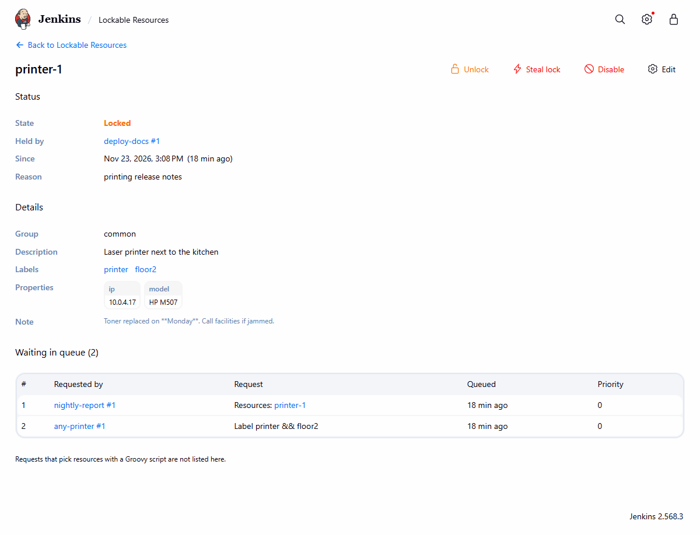

# Resource detail page

Implements [#1042](https://github.com/jenkinsci/lockable-resources-plugin/issues/1042).

Every resource has its own page at `/lockable-resources/resource/<name>/`.
On the **Resources** tab of the Lockable Resources page, click a resource name to open it.
The name is URL-encoded, so `lab printer #2` opens
`/lockable-resources/resource/lab%20printer%20%232/`.

The page shows:

- **Status**: free, reserved, locked, queued or disabled, and the disable cause.
- **Held by**: the build that holds the lock, the user who reserved the resource,
  or the remote client for a remote lock.
- **Since**: when the resource was locked or reserved, and how long ago that was.
- **Reason**: the lock or reservation reason.
- **Details**: group, description, labels, properties and the note.
- **Waiting in queue**: the builds waiting for this resource, in the order they will
  get it. Builds that ask for it by name are listed, and so are builds that ask for one
  of its labels or for any resource in its group. Requests that pick resources with a
  Groovy script are not listed, because the page would have to run the script to know.

## Actions

The buttons above the details are the same as in the resources table and need the same
permissions:

| Action                  | Permission                                     | Shown when                      |
|-------------------------|------------------------------------------------|---------------------------------|
| Reserve                 | Lockable Resources/Reserve                     | free and enabled                |
| Unreserve               | Lockable Resources/Reserve                     | reserved by you (admins: by anyone) |
| Reassign                | Lockable Resources/Steal                       | reserved by someone else        |
| Unlock                  | Lockable Resources/Unlock                      | locked by a build               |
| Steal lock              | Lockable Resources/Steal                       | locked and enabled              |
| Force release remote lock | Lockable Resources/Unlock                    | locked by a remote client       |
| Reset                   | Lockable Resources/Unlock                      | queued                          |
| Disable / Enable        | Lockable Resources/Configure                   | always                          |
| Edit                    | Lockable Resources/Configure                   | always                          |

**Edit** opens the same dialog as the edit button in the table, for the description,
labels, group and properties. To delete a resource, use the table.

Viewing the page needs the Lockable Resources/View permission, the same as the main page.
An unknown name returns *404 Not Found*.

## Manage Jenkins

The page also works under `/manage/lockable-resources/resource/<name>/`. There it
uses the Manage Jenkins layout, and the back link and all actions stay under
`/manage/`.
